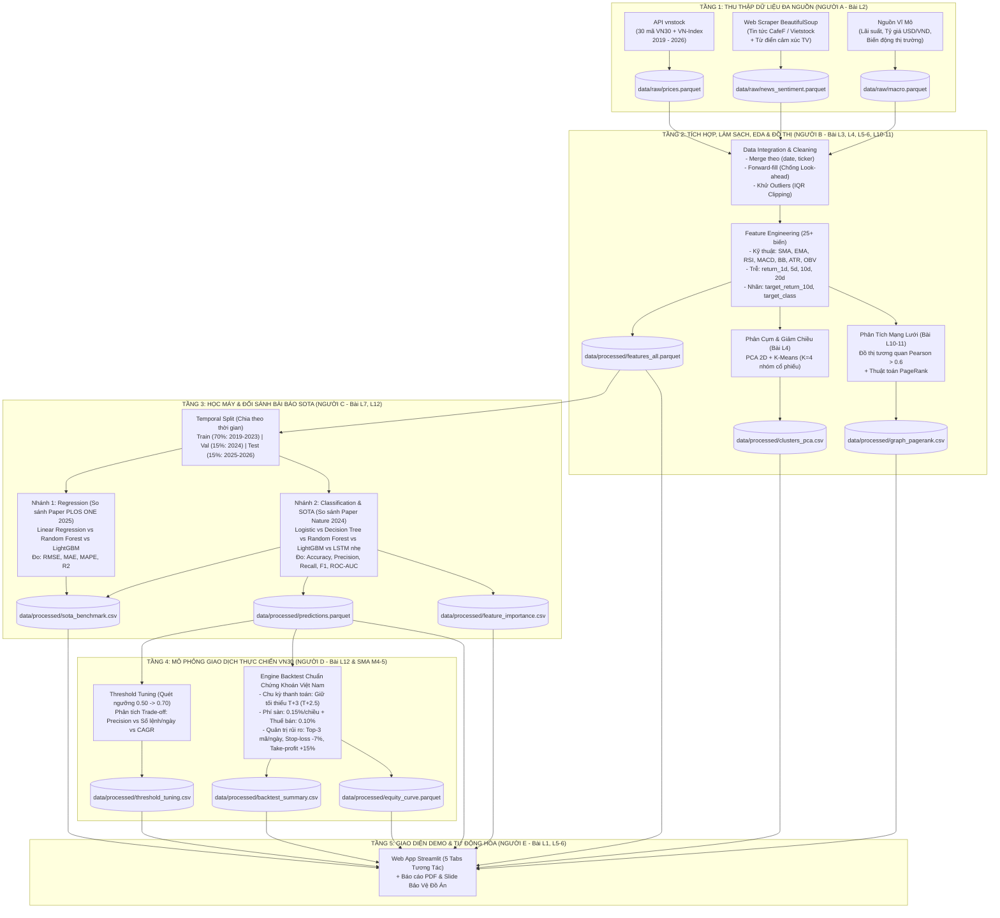

# FLOW.md — Kiến Trúc Luồng Dữ Liệu & Quy Trình Phối Hợp 5 Thành Viên (`projects/capstone/`)

> Tài liệu này trực quan hóa toàn bộ luồng chảy dữ liệu (Data Pipeline Flow), luồng phối hợp làm việc song song không nghẽn cổ chai (Parallel Teamwork Flow), và luồng tương tác của người dùng trên ứng dụng Web Demo.

---

## 1. Luồng Phối Hợp Làm Việc Song Song 5 Người (Parallel Execution Flow)

Để tránh tình trạng **Người B phải chờ Người A cào xong dữ liệu, Người C phải chờ Người B, Người D chờ Người C**, toàn bộ nhóm áp dụng mô hình **Schema-First & Mock Data Bootstrap**:

```text
┌──────────────────────────────────────────────────────────────────────────────┐
│ NGÀY 1 (KHỞI ĐỘNG - 15 PHÚT):                                                │
│ Chạy `python scripts/generate_mock_data.py`                                  │
│ ──> Sinh ngay toàn bộ file mẫu chuẩn 100% Schema vào `data/raw/` & `processed`│
└─────────┬──────────────┬──────────────┬──────────────┬──────────────┬────────┘
          │              │              │              │              │
          ▼              ▼              ▼              ▼              ▼
   ┌─────────────┐┌─────────────┐┌─────────────┐┌─────────────┐┌─────────────┐
   │  NGƯỜI A    ││  NGƯỜI B    ││  NGƯỜI C    ││  NGƯỜI D    ││  NGƯỜI E    │
   │ Code script ││ Code ghép   ││ Code train  ││ Code engine ││ Code UI 5   │
   │ kéo vnstock ││ bảng, 25+   ││ Linear, RF, ││ Backtest    ││ tab trên    │
   │ & cào tin   ││ chỉ báo TA, ││ LightGBM &  ││ T+2.5, phí  ││ Streamlit & │
   │ CafeF thật  ││ PCA/K-Means ││ LSTM nhẹ    ││ 0.15%, thuế ││ khung báo   │
   │             ││ & PageRank  ││ đối sánh    ││ 0.1%, tính  ││ cáo PDF     │
   │             ││             ││ 2 bài báo   ││ CAGR/Sharpe ││             │
   └──────┬──────┘└──────┬──────┘└──────┬──────┘└──────┬──────┘└──────┬──────┘
          │              │              │              │              │
          ▼              ▼              ▼              ▼              ▼
┌──────────────────────────────────────────────────────────────────────────────┐
│ GIAI ĐOẠN GHÉP NỐI (INTEGRATION - 1 LỆNH DUY NHẤT):                          │
│ Khi Người A kéo xong dữ liệu thật vào `data/raw/`, Người E chạy `main.py`:   │
│ `ingest/crawler` (A) ──> `features/graph` (B) ──> `models` (C) ──> `backtest`│
│ ──> Tự động cập nhật toàn bộ biểu đồ thật lên Streamlit App & Báo cáo PDF!   │
└──────────────────────────────────────────────────────────────────────────────┘
```

---

## 2. Luồng Chảy Dữ Liệu Đầu-Cuối (End-to-End Data Pipeline Flow)

Sơ đồ dưới đây mô tả chi tiết từng bước biến đổi dữ liệu từ nguồn thô trên Internet cho tới quyết định đầu tư cuối cùng (đáp ứng chuẩn sơ đồ quy trình môn **IT4930 Khoa học Dữ liệu**):



---

## 3. Luồng Chạy Tự Động Hóa (`main.py` Execution Flow)

Khi giảng viên hoặc hội đồng chấm yêu cầu *"Chạy thử chương trình từ đầu đến cuối"*, `main.py` hỗ trợ 2 chế độ chạy cực kỳ an toàn:

1. **Chế độ 1 — `python main.py --mode offline` (Mặc định khi Demo bảo vệ trên lớp)**:
   - Không phụ thuộc mạng Internet hội trường (tránh rủi ro rớt mạng hoặc CafeF/API phản hồi chậm).
   - Đọc trực tiếp từ bộ dữ liệu thật đã lưu trong `data/raw/`, chạy qua toàn bộ pipeline:
     `Bước 1 (Làm sạch & Tạo Feature - 3s)` $\to$ `Bước 2 (Chạy PCA/K-Means & Đồ thị PageRank - 2s)` $\to$ `Bước 3 (Huấn luyện & Đánh giá SOTA Benchmark - 15s)` $\to$ `Bước 4 (Mô phỏng Backtest T+2.5 - 3s)` $\to$ In bảng kết quả tổng hợp ra màn hình Terminal trong **dưới 25 giây**.
2. **Chế độ 2 — `python main.py --mode live` (Kéo dữ liệu mới nhất trong ngày)**:
   - Gọi `src/ingest.py` và `src/crawler.py` để kéo giá đóng cửa ngày hôm nay và cào tin tức mới nhất, sau đó chạy tiếp Bước 1 $\to$ Bước 4 và xuất danh sách **Top 3 cổ phiếu VN30 khuyến nghị MUA cho phiên ngày mai**.

---

## 4. Luồng Trải Nghiệm Trên Giao Diện Streamlit (`app/streamlit_app.py`)

Khi trình bày đồ án trước giảng viên (15 phút), nhóm sẽ mở ứng dụng Streamlit đi theo đúng 5 Tab khớp với trình tự bài giảng môn Khoa học Dữ liệu:

```text
[Tab 1: Thu Thập & Khám Phá Dữ Liệu (Người A)]
  ├── Chọn mã cổ phiếu VN30 (VD: FPT, HPG, VCB) & khoảng thời gian.
  ├── Hiển thị biểu đồ Nến (Candlestick) + Khối lượng + Đường SMA20/50.
  └── Bảng tin tức CafeF/Vietstock đã cào kèm nhãn Cảm xúc (Tích cực / Trung lập / Tiêu cực).
        │
        ▼
[Tab 2: Làm Sạch, Phân Cụm & Mạng Lưới Liên Kết (Người B)]
  ├── Thống kê dữ liệu trước & sau khi xử lý Missing/Outliers (minh chứng bài L3).
  ├── Biểu đồ Scatter 2D PCA + K-Means phân cụm 30 mã VN30 theo Rủi ro vs Lợi nhuận (minh chứng bài L4).
  └── Đồ thị mạng lưới tương quan VN30 + Bảng xếp hạng PageRank cổ phiếu dẫn dắt (minh chứng bài L10-11).
        │
        ▼
[Tab 3: Học Máy & Đối Sánh Bài Báo SOTA (Người C)]
  ├── Bảng Benchmark đối đầu: Linear/Logistic vs Decision Tree vs Random Forest vs LightGBM vs LSTM.
  ├── Khung đối chiếu trực tiếp với kết quả 2 bài báo Nature (2024) và PLOS ONE (2025).
  └── Biểu đồ Top 15 Feature Importance giải thích yếu tố nào quyết định xu hướng giá.
        │
        ▼
[Tab 4: Mô Phỏng Chiến Lược Giao Dịch T+2.5 (Người D)]
  ├── Biểu đồ Threshold Tuning: Thay đổi ngưỡng xác suất (0.50 -> 0.70) ảnh hưởng tới Precision & CAGR.
  ├── Thanh trượt tương tác (Sliders): Chọn Vốn ban đầu, Ngưỡng xác suất, Mức cắt lỗ (Stop-loss).
  └── Đường cong tăng trưởng tài sản (Equity Curve) của AI Strategy so với Buy & Hold VN-Index.
        │
        ▼
[Tab 5: Khuyến Nghị Tín Hiệu Hôm Nay (Người E)]
  └── Bảng xếp hạng Top-3 mã cổ phiếu VN30 có xác suất tăng trưởng cao nhất trong chu kỳ tới.
```
